<div align="center">

# WEBOS-FW-BLOCK

**Block LG firmware updates on rooted LG webOS TVs, and keep your root.**

[](https://github.com/ohmybahgosh/WEBOS-FW-BLOCK/actions/workflows/ci.yml)
[](https://github.com/ohmybahgosh/WEBOS-FW-BLOCK/releases/latest)
[](#which-tvs)
[](#install)
[](SECURITY.md#verifying-a-download)
[](fw-block.sh)
[](LICENSE)

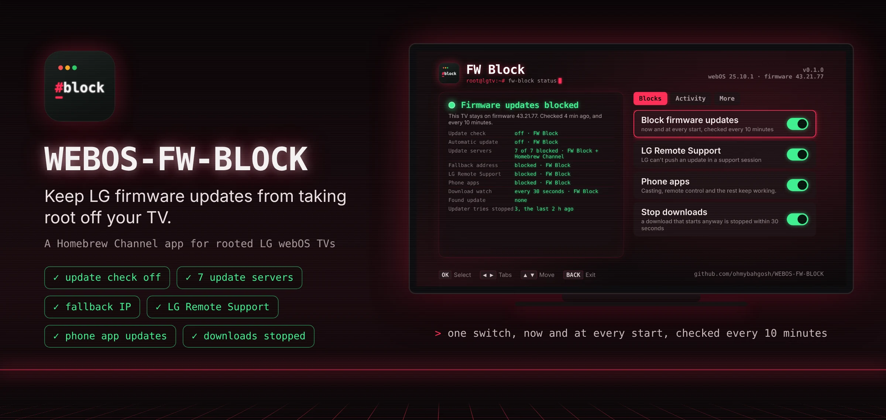

**[Install](#install)** · **[What it blocks](#what-it-blocks)** · **[The TV app](#the-tv-app)** · **[With LG-USB-2-ETH0](#with-lg-usb-2-eth0-and-the-homebrew-channel)** · **[FAQ](#faq)**

</div>

One firmware update can take root off your LG TV for good, along with everything you installed through the Homebrew Channel.  LG's current firmware patches the known ways to root a TV, so once a patched update installs, there may be no way back.

**FW Block** closes every route to a firmware update we found by running LG's own updater in a sandbox and reading the update code of nine firmwares, from 2018 models to webOS 26.  It keeps those routes closed, stops a download that starts anyway, and shows you exactly what's blocked and who blocks it.  It's one switch in a TV app you run with the remote, through the [Homebrew Channel](https://github.com/webosbrew/webos-homebrew-channel), with the same script underneath for SSH.

> [!IMPORTANT]
> **Every way LG can update the TV that we found, closed:**
>
> | LG's way in | What FW Block does |
> |---|---|
> | The updater's own check, from the moment the TV starts | Turns webOS's hidden update check and **Automatic software update** off |
> | An update webOS already found | Deletes it before it can install |
> | LG's seven update servers | Sends all of them nowhere, including the three the Homebrew Channel's switch misses |
> | The address the updater uses with no name | Drops it with a firewall rule |
> | LG Remote Support pushing an update | Blocks its servers and addresses |
> | A phone app (LG ThinQ) pushing an update from the phone | The TV's phone connection stops offering it, while casting and the phone remote keep working |
> | A download that starts anyway | Cancelled within 30 seconds, with a notice on the TV |
>
> It checks all of it every 10 minutes and at every start, and puts back anything that was undone.  [What it blocks](#what-it-blocks)

> [!NOTE]
> **Tested on one TV so far.**  It runs on a real LG C2 with webOS 25 and passes its tests against a fake TV under the TV's own shell, but it hasn't met many other TVs yet.  If something looks wrong, please open a [bug report](https://github.com/ohmybahgosh/WEBOS-FW-BLOCK/issues/new?template=bug-report.yml), and a [TV report](https://github.com/ohmybahgosh/WEBOS-FW-BLOCK/issues/new?template=tv-report.yml) helps even when it works.

<details>
<summary><b>How this is built: AI-assisted, tested on a real TV</b></summary>

<br>

I, [OhMyBahGosh](https://github.com/ohmybahgosh), build FW Block with AI coding agents (Claude), directed, reviewed and tested by me.  AI writes a lot of the code here; I decide what it does, check how it does it, and nothing ships until it's run on a real TV (an LG C2 on webOS 25).

The fixes that mattered most came from that real-TV testing, not from the AI: `luna-send` quietly eating the script's input so the status came back blank, the TV's fonts missing a symbol the app drew, LG-USB-2-ETH0's new phone block looking like a gap until the TV's next start, and the status claiming FW Block was adding blocks while it was off.  The research behind the blocks came from running LG's own updater in a sandbox and reading nine firmwares (see [How we checked](#how-we-checked)), building on LG-USB-2-ETH0's `--block-updates` and the findings in Homebrew Channel issue #96 and PR #264.  The [changelog](CHANGELOG.md) has the full story.

- **Tests on every push:** 78 [tests](tests/run.sh) run the script against a fake TV (its own `/etc/hosts`, settings service, firewall, phone gateway and update folders) under busybox `sh` (the TV's shell), dash and bash, along with ShellCheck, a translation check, the release signing checks, a build of the TV app and its screens in a browser.  The CI badge above shows the latest run.
- **Signed releases:** an update only installs if its release is signed with the project's key, which only GitHub Actions uses, from an encrypted secret ([SECURITY.md](SECURITY.md#verifying-a-download)).  The Homebrew Channel checks the download's SHA-256 too.
- **Hard to break the TV:** no system partition is written, no system service is restarted, a backup is saved before every change, and turning it off or uninstalling undoes everything it added.

Commits list me as the author and Claude as the committer, which is why they show as Verified.  Found a problem?  See [SECURITY.md](SECURITY.md) or open an issue.

</details>

## Standout features

- **One switch, and it's done.**  **Block firmware updates** turns everything on, now and at every start.  Each part has its own switch with a line on what it does, and the status shows who keeps each block: FW Block, LG-USB-2-ETH0 or the Homebrew Channel.  [The TV app](#the-tv-app)
- **More than a hosts file.**  The Homebrew Channel's **Block system updates** covers four servers.  FW Block also turns the update check itself off, blocks the other three servers and the address with no name, and closes the side doors: LG Remote Support, phone apps and a download that starts anyway.  [Why not just the Homebrew Channel's switch?](#why-not-just-the-homebrew-channels-switch)
- **Phone apps blocked, casting still works.**  A paired phone app can push a firmware update straight from the phone, past every server block.  FW Block takes away only the update calls, so casting, the phone remote and the ThinQ app keep working.  [Phone apps](#what-it-blocks)
- **Keeps itself closed.**  Every 10 minutes and at every start it checks all seven parts, puts back anything undone, deletes an update webOS found, and counts the times it stopped the updater.  **What it caught** shows all of it.
- **Automatic backups.**  Before it turns on, restores or updates, FW Block saves what things were, so **Backups** can put them back.  [Backups](#backups)
- **Signed updates from the app.**  **Updates** installs a new version through the Homebrew Channel, but only a release signed with the project's key.  [Updates](#updates)
- **Plays well with others.**  It never changes the Homebrew Channel's or LG-USB-2-ETH0's settings, adds only what they don't already block, and turning it off never turns theirs off.  [With LG-USB-2-ETH0](#with-lg-usb-2-eth0-and-the-homebrew-channel)
- **Undo in one press, and clean uninstalls.**  **Turn FW Block off** removes only what it added.  Uninstall the app and it cleans up after itself within 30 seconds.  [Turning it off and uninstalling](#turning-it-off-and-uninstalling)
- **Hard to break the TV.**  No system partition is written, no system service is restarted, an install already running is never interrupted, and USB updates you start yourself are left alone.  [SECURITY.md](SECURITY.md) lists everything it does as root.

## Contents

- [Install](#install)
- [Why not just the Homebrew Channel's switch?](#why-not-just-the-homebrew-channels-switch)
- [What it blocks](#what-it-blocks)
- [The TV app](#the-tv-app): [backups](#backups), [updates](#updates)
- [With LG-USB-2-ETH0 and the Homebrew Channel](#with-lg-usb-2-eth0-and-the-homebrew-channel)
- [How we checked](#how-we-checked) and [which TVs](#which-tvs)
- [Is it safe?](#is-it-safe)
- [Turning it off and uninstalling](#turning-it-off-and-uninstalling)
- [Over SSH](#over-ssh)
- [FAQ](#faq) and [troubleshooting](#troubleshooting)
- [Development](#development), [help and contributing](#help-and-contributing), [license](#license)

## Install

You need a rooted LG webOS TV with the [Homebrew Channel](https://github.com/webosbrew/webos-homebrew-channel) ([RootMyTV](https://rootmy.tv), [faultmanager-autoroot](https://github.com/throwaway96/faultmanager-autoroot), crashd, DejaVuln and the rest).  Not rooted yet?  Check your firmware at [CanI.RootMy.TV](https://cani.rootmy.tv/), and keep updates off until you are.

**From the Homebrew Channel (easiest):**

1. Open the Homebrew Channel, then **Settings**, then **Add repository**, and enter `https://ohmybahgosh.dev/repo`.
2. Back in the app list, install **FW Block**.
3. Open it and turn on **Block firmware updates**.  That's it: firmware updates are blocked now and at every start.

**Or install the IPK yourself:** download `org.ohmybahgosh.fwblock_*_all.ipk` from the [latest release](https://github.com/ohmybahgosh/WEBOS-FW-BLOCK/releases/latest) and install it with [webOS Dev Manager](https://github.com/webosbrew/dev-manager-desktop) or `ares-install`.  Every release file is signed ([how to check](SECURITY.md#verifying-a-download)).

**Over SSH, without the app:**

```sh
wget -O /tmp/fw-block.sh https://github.com/ohmybahgosh/WEBOS-FW-BLOCK/releases/latest/download/fw-block.sh
sh /tmp/fw-block.sh status   # see what's blocked first (changes nothing)
sh /tmp/fw-block.sh on       # block now and at every start
```

The phone app block takes hold from the next TV start (the TV's phone connection reads its settings when it starts), so the app offers to restart the TV right after you turn it on.  Over SSH, run `sh fw-block.sh restart`.

## Why not just the Homebrew Channel's switch?

The Homebrew Channel's **Block system updates** sends four of LG's servers nowhere in `/etc/hosts`.  It's a good start, and FW Block keeps it.  But the webOS updater also knows `nsu.lge.com`, `snu-dev.lge.com` and `ngfts.lge.com`, has an address it reaches with no name to block, and still checks for updates on its own.  People still get update notices with that switch on ([webosbrew#96](https://github.com/webosbrew/webos-homebrew-channel/issues/96)).  And none of that touches LG Remote Support or a phone app pushing an update.

<p>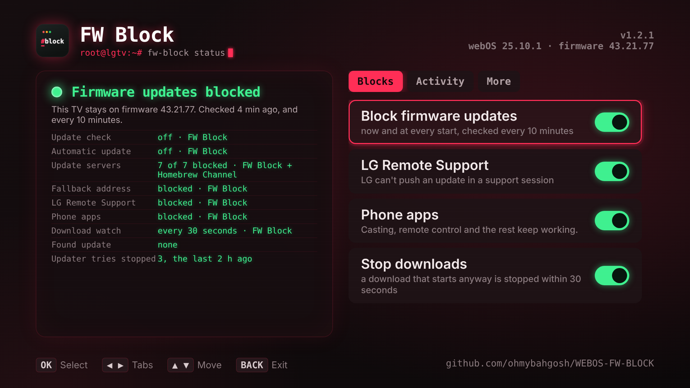 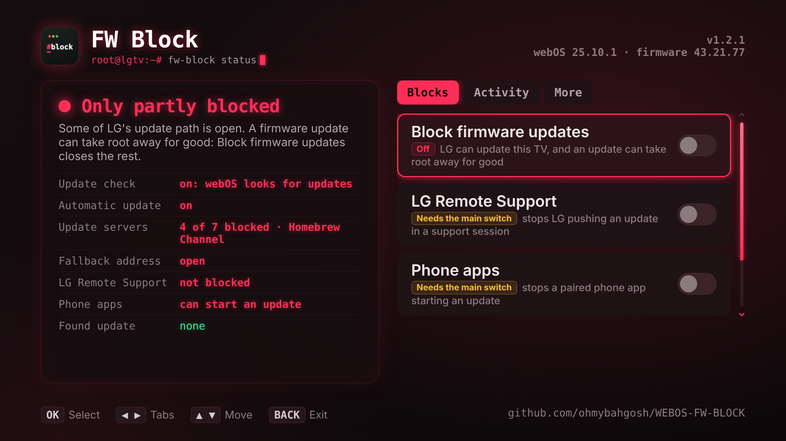</p>

## What it blocks

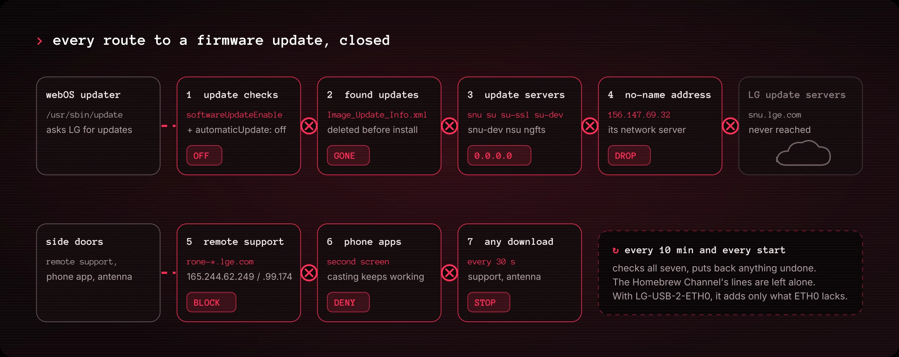

The main route, the updater asking LG:

1. **webOS's update checks are turned off.**  Both of them: a hidden setting (`softwareUpdateEnable`, in the `support` category of webOS's settings service) and the visible **Automatic software update** (`automaticUpdate`).  The automatic check reads both.  With them off, the updater doesn't even ask.  They're saved settings, so they hold from the moment the TV starts, before anything else is in place.
2. **Updates it already found are deleted** (`Image_Update_Info.xml` and `Package_Update_Info.xml` in `/mnt/lg/cmn_data/swupdate`), so a found update can't install and a waiting prompt goes away.
3. **All seven update servers go nowhere** in `/etc/hosts`: `snu`, `su`, `su-ssl`, `su-dev`, `snu-dev`, `nsu` and `ngfts.lge.com`.  It only adds the ones nothing else blocks yet, so the Homebrew Channel's lines stay as they are.
4. **The address with no name is dropped.**  LG can switch the updater to its "network" server, and then it goes straight to `156.147.69.32`, which a hosts file can't touch.  One firewall rule drops it, in a chain of its own (`FWBLOCK`), so it's easy to see and easy to remove.

The side doors, where the updater gets a download without asking:

5. **LG Remote Support is blocked.**  During a support session, LG's `remotediag` can hand the updater a download address directly.  Its servers (`rone-tv-*.lge.com`, `rone-*.lge.com`) and the two addresses it uses without a name (`165.244.62.249`, `165.244.99.174`) are blocked.  You can turn this one off in the app if LG support ever needs to connect.
6. **Phone apps can't start an update.**  A paired phone app with LG's "update from remote app" permission can tell the TV to update from a file on the phone.  That download comes straight from the phone over your home network, so no server block touches it, and in our tests the TV never even reported it as downloading.  The TV's phone connection (its second-screen gateway) reads what phones may call from one small file per service.  FW Block covers the update service's file with a copy that keeps only its read-only version calls, the same way the hosts file is covered.  We loaded both files with LG's own gateway code: on webOS 25 and 26, every other phone call stays exactly the same (374 of 377, and 393 of 398), so casting, remote control, the ThinQ app and the rest keep working.  A phone that tries an update gets "no such service or method".  The gateway reads that file when it starts, so the block holds from the next TV start, and after that from every start.
7. **A download that starts anyway is stopped.**  A support session or the antenna (some regions send updates over the air) can start one.  FW Block looks every 30 seconds, cancels a download, and shows a notice on screen.  An install that's already running is only reported, because stopping one could break the TV.  USB updates, which you start yourself, are left alone.

Then it **keeps it closed**: every 10 minutes (and at every start) it checks all seven, puts back anything that was undone, deletes an update webOS found, and counts the times it stopped the updater or Remote Support.  It also reports LG's own flag files without changing them: a switch to another update server, a forced update, and debug overrides.

## The TV app

Three tabs, sized for a big screen and the remote, in English, Russian or Spanish:

- **Blocks:** **Block firmware updates** (the main switch), **LG Remote Support**, **Phone apps** and **Stop downloads**, each with a line on what it does.  A tag says why a switch is off: your choice, needs the main switch, or kept by another app.
- **Activity:** **Check now** (puts back anything undone), **Test the block** (tries every route), **What it caught** (every updater try stopped, update deleted and part put back), **Every block, and who keeps it**, and **Clean up** (downloaded firmware and LG's flag files).
- **More:** **What each block does** (every block explained, one page each), **Pause for a planned update**, **Notices on the TV**, **Updates**, **Backups**, **Help and report** (a short report to paste into an issue), **Language** and **About**.

Green means blocked, amber means waiting (like the phone block before the next start) or off by your choice, and red means open.

<p>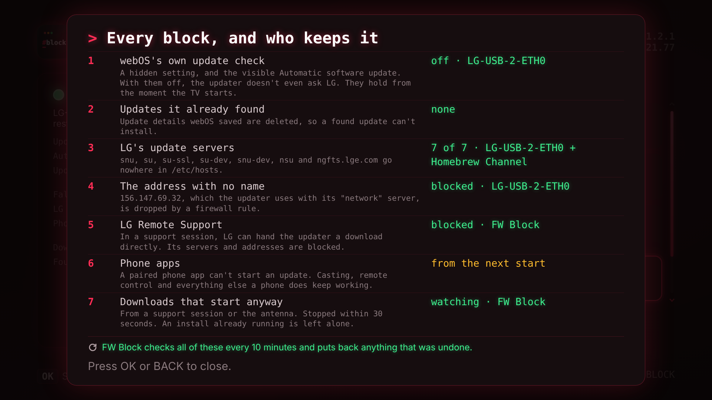 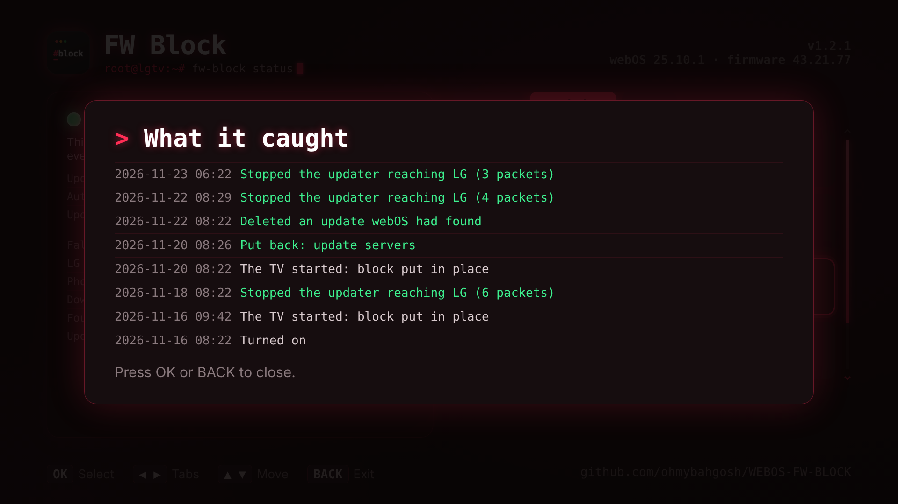</p>

<p>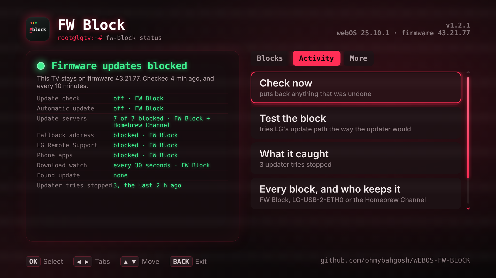 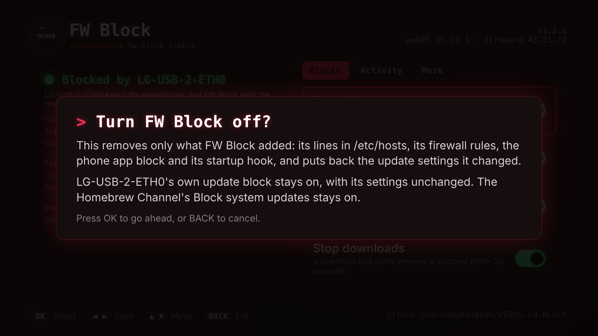</p>

### Test the block

**Test the block** tries LG's update path the way the updater would, whoever blocks it: it reads both update settings, looks up every update and Remote Support server, and tries to connect to the addresses with no name (nothing is sent, and a connection that opens is closed right away).  It first checks the TV can reach GitHub, so a missing network isn't mistaken for a block.  Each route shows as blocked, open or waiting for the next start.  It only connects when you choose it; **Help and report** has a version read from the settings alone.

### Clean up

Firmware LG downloaded before the block (often over a gigabyte) can stay on the TV.  **Clean up** lists those files, and LG's flag files that can force an update, turn on its debug options or switch the update server.  It deletes either on request: never while an update runs, and only after a backup that lists the firmware files and keeps copies of the flag files.  The blocks work with or without them.

### Pause for a planned update

For an update you want (one you know keeps root), **Pause for a planned update** takes FW Block's blocks off for 1, 3 or 24 hours and puts them back by itself when the time is up or at the next TV start, whichever comes first.  A backup is saved first, and the app reminds you if LG-USB-2-ETH0 or the Homebrew Channel still block updates too.

### Notices on the TV

When something undoes a block and FW Block puts it back, or it stops a download, the TV shows a short notice, in the app's language.  The same thing never gets more than one notice a day.  Turn them off under **Notices on the TV**.

<p>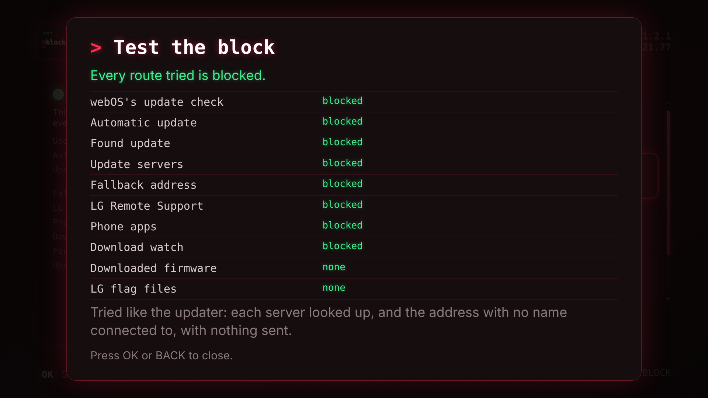 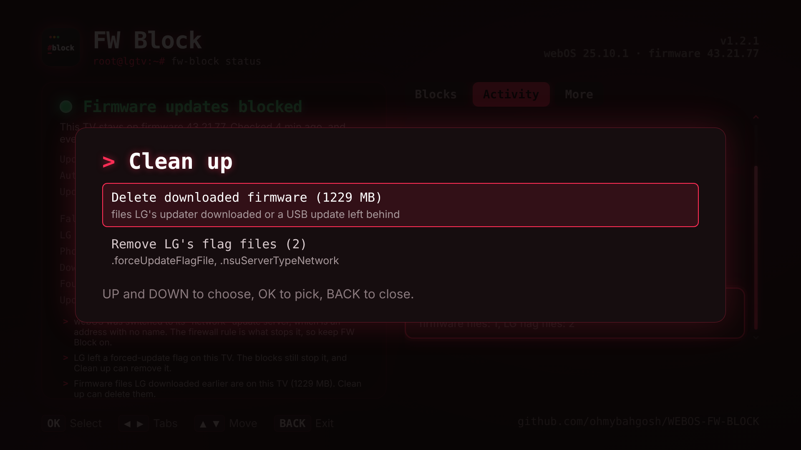</p>

<p>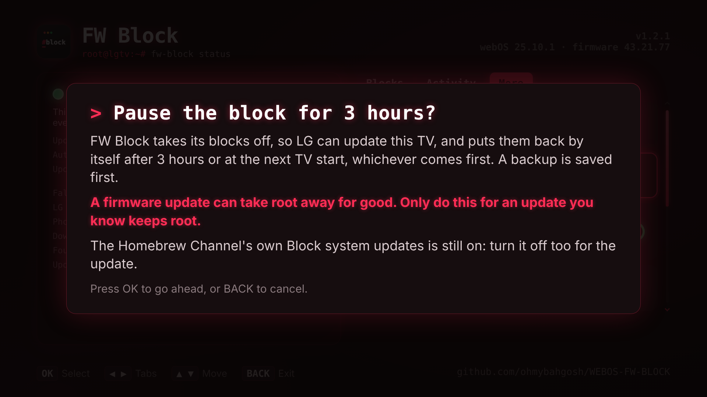 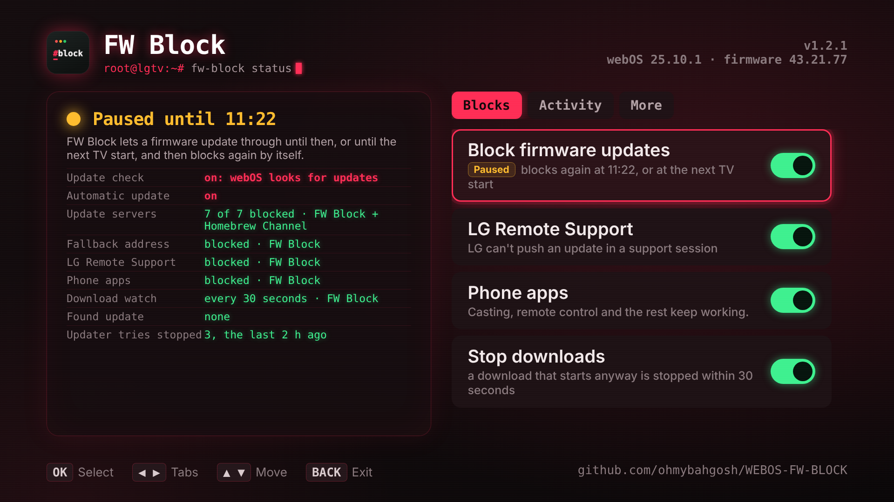</p>

### Backups

Before FW Block turns the block on, restores a backup or installs an update, it saves a backup by itself: webOS's two update settings, its own switches, a copy of `/etc/hosts`, the phone gateway's update file and the firewall's rules.  The newest 10 are kept, in `/var/lib/webosbrew/webos-fw-block/backups`.  **Backups** in the More tab lists them, makes one on demand, and **restores** one: FW Block's switches and webOS's update settings go back to how they were, and FW Block turns on or off to match.  A backup of how things are right then is saved first, so a restore can be undone too.

### Updates

Each time it opens, the app asks GitHub for a newer release, and **Updates** in the More tab says whether there is one.  When there is, an **Update to v…** row appears at the top of the More tab, the tab gets a dot, and the first time it's found the app opens on it (unless you've already started using the remote).

<p>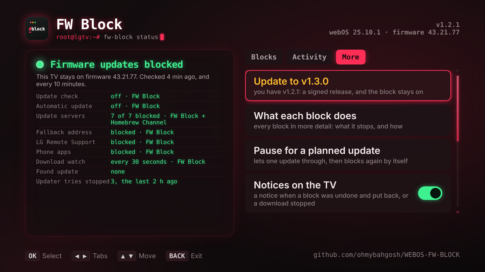</p>  Choose it to see what's new, then OK: the Homebrew Channel downloads and installs it, and the app opens again by itself to show what changed.  The block stays on the whole time.

Only a release signed with the project's release key (or its backup key, in case the main one is ever lost) is accepted, only from this project's own release address, and the Homebrew Channel checks the download's SHA-256 before it installs.  That check, and **Test the block** when you choose it, are the only network requests FW Block makes, and only when the app is open.  [SECURITY.md](SECURITY.md#verifying-a-download) has the keys.

<p>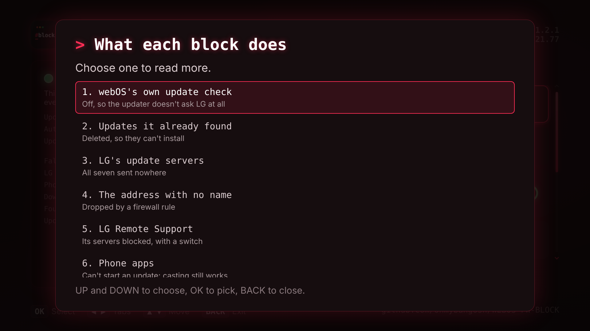 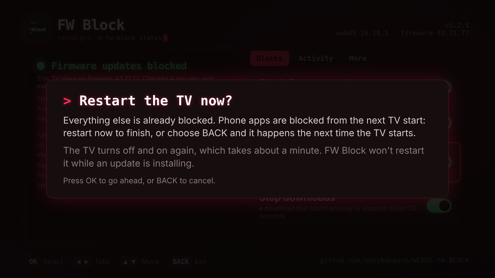</p>

<p>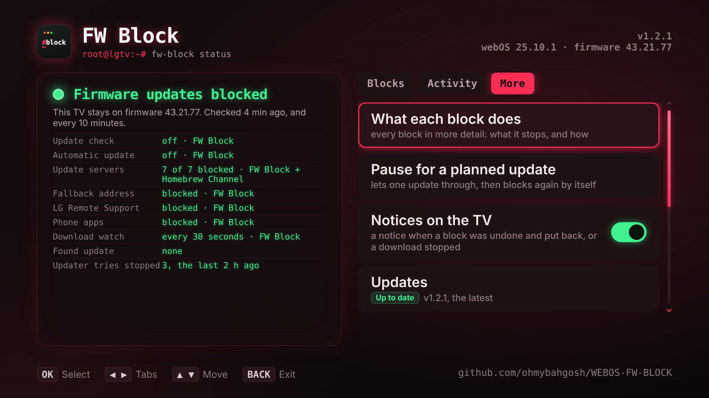 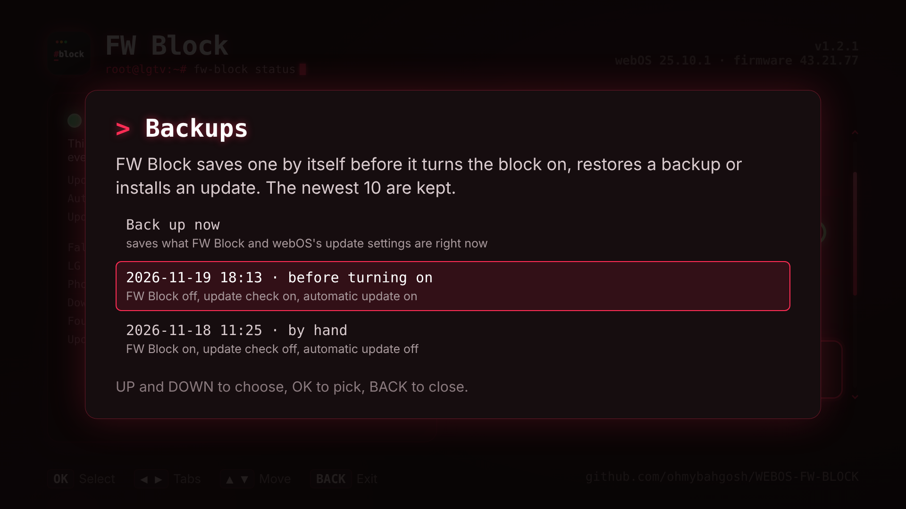</p>

## With LG-USB-2-ETH0 and the Homebrew Channel

[LG-USB-2-ETH0](https://github.com/ohmybahgosh/LG-USB-2-ETH0) blocked updates first, with **Block updates harder** (`--block-updates`), and newer versions block phone apps and stop downloads too.  If you use it, you don't need FW Block, but the two work together, and FW Block can stay on as a backup.

| | Who keeps it |
|---|---|
| Update check, found updates, update servers, the address with no name | LG-USB-2-ETH0 when its **Block updates harder** is on, otherwise FW Block |
| Automatic software update | LG-USB-2-ETH0 (2.11.45 and later) with its block on, otherwise FW Block |
| LG Remote Support | LG-USB-2-ETH0 when its **Block LG Remote Support** is on, otherwise FW Block |
| Phone apps | LG-USB-2-ETH0 when its **Block phone app updates** is on, otherwise FW Block |
| Downloads that start anyway | LG-USB-2-ETH0 when its **Stop firmware downloads** is on, otherwise FW Block |
| The Homebrew Channel's four servers | The Homebrew Channel's **Block system updates**, when it's on |

- **They never fight.**  FW Block adds only what nothing else blocks, and reads the others' settings to know.  The status and **Every block, and who keeps it** name who keeps each part.
- **Turning one off never turns the other's off.**  Turn LG-USB-2-ETH0's block off and FW Block takes over within 10 minutes.  Turn FW Block off and LG-USB-2-ETH0's block, and the Homebrew Channel's, stay exactly as they were.  The app says so before you confirm.
- **[Glasshouse](https://github.com/rorygallagher2024/glasshouse)'s ad block** keeps its own table over `/etc/hosts` and drops lines it didn't write unless they sit under its "Kept from /etc/hosts" header.  FW Block adds that header (once) before its own lines, so they stay through Glasshouse's rewrites.
- **Other blockers** (APL Launcher's hosts lines, `webos_lockout`'s and `lg-tv-blocklist`'s firewall chains) are recognized and left alone.

<p>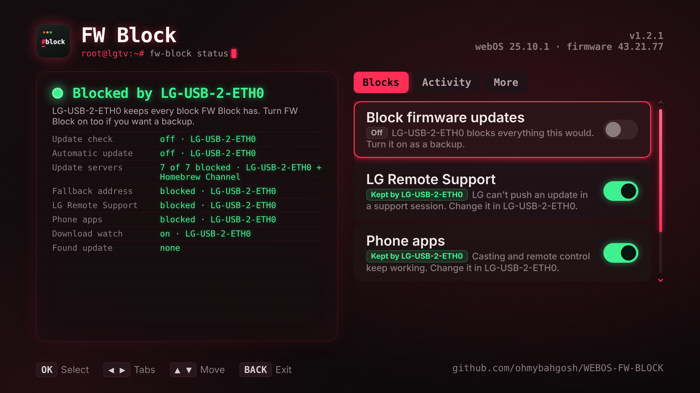 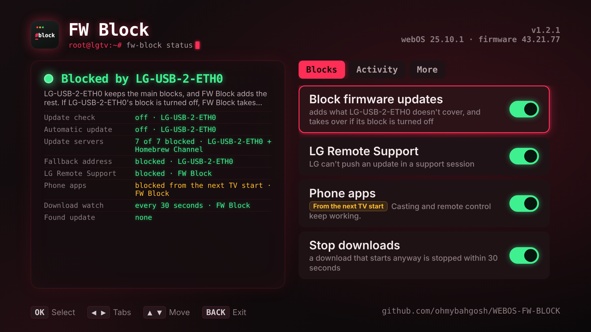</p>

## How we checked

We didn't guess at these.  LG's own updater, from a C2's firmware (33.31.68), was run under an ARM emulator, with LG's message bus, on a network with no way out where every address answers locally and every lookup and connection is logged.  We asked it to check for updates with and without FW Block's blocks, under every update server type and debug override, and with lookups failing outright.  Then we compared the update code of these firmwares, from LG's own download files:

| Firmware | TVs | webOS | Update servers and address | Remote Support | Side doors in the code |
|---|---|---|---|---|---|
| 05.50.70 (W18O) | 2018 OLED | 4 | `snu`, `su-dev`, same address | 7 of the 9 hosts, same 2 addresses | phone app, remote support |
| 04.64.00 (W20P) | 2020 (K6LP) | 6 | same 5 names, same address | same 9 hosts and 2 addresses | phone app, remote support, antenna, mobile FOTA |
| 03.53.45 (W21O) | 2021 OLED | 6 | same | same | the above, plus antenna updates in standby |
| 03.53.45 (W21A) | 2021 budget LED | 6 | same | same | the above, plus antenna updates in standby |
| 33.31.75 (W22H) | 2022 LED and QNED | 25 | same | same | phone app, remote support, antenna, mobile FOTA |
| 33.31.68 (W22O) | 2022 OLED (C2) | 25 | same | same | same, run in the emulator |
| 43.21.94 (W22O) | 2022 OLED, root patched | 26 | same | same | phone apps can also start a normal update |
| 43.21.73 (W24O) | 2024 OLED | 26 | same | same | phone apps can also start a normal update |
| 33.31.80 (W25P) | 2025 LED | 25 | same | same | phone app, remote support, antenna, mobile FOTA |

Every firmware checked uses the same update servers (or fewer) and the same address, and FW Block blocks every one.  Only the updater itself contains them, and its name lookups go through `/etc/hosts`.  `ngfts.lge.com` isn't in any updater we checked; it stays blocked because other blockers list it.

### Which TVs

Any rooted LG webOS TV with the Homebrew Channel should work: the update path and the phone gateway's file are the same in every firmware above, from webOS 4 (2018) to webOS 26.  It has been run on a real 2022 C2 with webOS 25.  On firmware without the phone gateway's update file, that part says "Not needed" and the rest works as usual.  Tried it on another TV?  A [TV report](https://github.com/ohmybahgosh/WEBOS-FW-BLOCK/issues/new?template=tv-report.yml) helps, whether it worked or not.

## Is it safe?

- **No system partition is written.**  The two system files it covers, `/etc/hosts` and the phone gateway's update file, get a copy in `/tmp` bind-mounted over them, the way the Homebrew Channel covers `/etc/hosts`, redone at every start.  The originals are never changed.
- **No system service is restarted,** no LG program is deleted or renamed, and an install already running is never interrupted.
- **Never touches another app.**  The Homebrew Channel's settings, LG-USB-2-ETH0's settings, lines and rules, and other blockers' rules stay as they are.
- **Backups before every change,** and **Turn FW Block off** puts webOS's update settings back the way they were.
- **When in doubt, updates stay blocked.**  It never turns webOS's update check back on while LG-USB-2-ETH0 or the Homebrew Channel keeps it off, and if LG-USB-2-ETH0 turned a setting off first, FW Block saves LG-USB-2-ETH0's record of the original, not the "off" it left.  Every original it saves goes in a log that's never rewritten.
- **Nothing half-done.**  Settings are written to a new file and checked before they replace the old one, `/etc/hosts` is copied before FW Block takes its lines out and checked that only those went, and anything that can't be undone keeps what it needs to try again.
- **Uninstall detection that can't misfire:** checked twice, never during an app update, and only when the Homebrew Channel's own app is visible too (so storage that isn't mounted yet doesn't look like an uninstall).
- **No network requests,** except the update check from the app, against a signed release.  It opens no ports and sends nothing about you or your TV anywhere.
- **Tested on every push:** the script runs against a fake TV (its own `/etc/hosts`, settings service, firewall, phone gateway and update folders) under busybox `sh` (the TV's shell), dash and bash, along with ShellCheck, a translation check, the signing checks, a build of the TV app and its screens in a browser.

It can't undo an update that already installed, and it doesn't block the LG Content Store.  **One thing only you can do:** don't start an LG Remote Support session while the TV is rooted, and until the TV has restarted once with FW Block on, don't accept an update from a phone app.

## Turning it off and uninstalling

**Turn the block off** (the main switch, or `sh fw-block.sh off`) removes only what FW Block added: its `/etc/hosts` lines, its firewall chain, the phone app block and its startup hook.  It puts webOS's two update settings back the way they were (the hidden one stays off while LG-USB-2-ETH0 still blocks updates).  LG-USB-2-ETH0's and the Homebrew Channel's blocks stay exactly as they were.

**Uninstalling:** remove it the usual way, from the Homebrew Channel or the TV's app list.  webOS doesn't let an app run anything as it's removed, so FW Block notices on its own: within about 30 seconds (or at the next start, if the TV was off), it undoes everything it added, exactly like turning it off, then deletes its startup hook and its folder in `/var/lib/webosbrew`.  It checks twice, a few seconds apart, and never while an update of the app is installing, so updating never counts as an uninstall.

If you turned it on over SSH without the app, run `sh fw-block.sh off` before deleting the script.

## Over SSH

`fw-block.sh` works on its own too.  It's inside the app at `/media/developer/apps/usr/palm/applications/org.ohmybahgosh.fwblock/assets/fw-block.sh`, and while the block is on, a copy lives in `/var/lib/webosbrew/webos-fw-block/`, so it keeps working even if the app is removed:

```sh
sh fw-block.sh status          # what's blocked, what isn't, and who blocks it (--json too)
sh fw-block.sh on              # block now and at every start
sh fw-block.sh off             # undo everything it added
sh fw-block.sh remote off      # stop blocking LG Remote Support (remote on to block it again)
sh fw-block.sh phone off       # let phone apps start an update again (phone on to block)
sh fw-block.sh guard off       # stop watching for downloads (guard on to watch again)
sh fw-block.sh check           # check now and put back anything that was undone
sh fw-block.sh events          # what it caught and fixed
sh fw-block.sh backups         # the backups it made; backup makes one, restore NAME puts one back
sh fw-block.sh update-check    # a newer release?  update-install gets it
sh fw-block.sh changes         # what changed in this version
sh fw-block.sh restart         # restart the TV now (refused during an update)
sh fw-block.sh test            # try every route the way the updater would (--json too)
sh fw-block.sh clean           # delete downloaded firmware files (after a backup)
sh fw-block.sh flags-clear     # remove LG's force, debug and server-switch flag files (after a backup)
sh fw-block.sh pause 60        # let updates through for 60 minutes (or until the next start); resume ends it
sh fw-block.sh alerts off      # no notices on the TV (alerts on to bring them back)
sh fw-block.sh report          # a short report for asking for help
```

## FAQ

**What if the Homebrew Channel's own block starts turning the update check off too?**
A pending Homebrew Channel change (webosbrew PR #264) does that.  FW Block already checks the installed Homebrew Channel for it, names it as what keeps the update check off, and never turns the check back on behind it.

**Does turning FW Block off turn off LG-USB-2-ETH0's block, or the Homebrew Channel's?**
No.  FW Block only removes what it added itself.  Their settings, `/etc/hosts` lines and firewall rules stay exactly as they were.

**I already use LG-USB-2-ETH0's Block updates harder.  Do I need this?**
No.  Newer LG-USB-2-ETH0 versions block everything FW Block does.  If you install both, FW Block shows that LG-USB-2-ETH0 keeps each block, stays out of its way, and takes over if LG-USB-2-ETH0's block is ever turned off.

**Will casting, the phone remote and the ThinQ app still work?**
Yes.  The phone block only takes away the update service's update calls.  Every other phone call stays the same, which we checked with LG's own gateway code on webOS 25 and 26.

**Why does the phone block say "from the next TV start"?**
The TV's phone connection reads which calls it offers when it starts, and FW Block never restarts just that part (it's shared with other parts of webOS).  Restart the TV once and it holds from then on: the app offers to do it for you right after you turn the block on.

**I still see an update notice.**
Open **Check now**.  If webOS had already found an update before FW Block was on, it's deleted and the notice goes away.  If a notice keeps coming back, please open a [bug report](https://github.com/ohmybahgosh/WEBOS-FW-BLOCK/issues/new?template=bug-report.yml) with the app's **Help and report**.

**Can it undo an update that already installed?**
No.  Nothing can undo a firmware update from the TV.  Block updates before LG gets the chance.

**Does it block apps from updating?**
No.  The LG Content Store and app updates are left alone.  Only firmware updates are blocked.

**What if LG support needs to connect?**
Turn off **LG Remote Support** in the Blocks tab first, and back on afterwards.  But on a rooted TV, it's safer not to start a support session at all.

**Is it really free?**
Yes.  Free and open source under the [MIT License](LICENSE), with no ads, tracking or accounts.

## Troubleshooting

- **"No root access" in the app:** open the Homebrew Channel once and check it says the system is rooted, then open FW Block again.
- **Something shows as open:** choose **Check now**, which puts back anything undone.  If it stays open, **Help and report** gives a short report to paste into an issue.
- **Updates says it couldn't check:** the TV needs to reach `github.com`.  Nothing else is affected: the block works the same without it.
- **Want it gone completely:** turn it off, then uninstall the app.  It also cleans up on its own if you just uninstall.

## Languages

English, Russian and Spanish, following the TV's menu language, like LG-USB-2-ETH0 and SSH Doctor.  **Language** in the More tab switches by hand.

## Development

The script is POSIX `sh` for busybox; the TV app is plain ES5 JavaScript for old webOS browsers.  Everything is tested without a TV:

```sh
sh tests/run.sh busybox                 # the script against a fake TV (also dash and bash)
node tests/check-i18n.js                # every text translated
sh webos-app/build.sh                   # the IPK (needs ares-package from @webos-tools/cli)
node tests/check-signing.js .cache/tweetnacl-1.0.3-nacl-fast.min.js   # release signatures
sh scripts/screenshots/make-demo.sh     # demo data from real runs on fake TVs
python3 scripts/screenshots/shoot.py    # the TV screens in a browser (Playwright)
```

## Help and contributing

- **Stuck?**  Ask in [Discussions > Q&A](https://github.com/ohmybahgosh/WEBOS-FW-BLOCK/discussions/new?category=q-a).
- **Something broken?**  Open a [bug report](https://github.com/ohmybahgosh/WEBOS-FW-BLOCK/issues/new?template=bug-report.yml) with the app's **Help and report**.
- **Tried it on your TV?**  A [TV report](https://github.com/ohmybahgosh/WEBOS-FW-BLOCK/issues/new?template=tv-report.yml) helps, whether it worked or not.  Seen an update server or address it misses?  That's the most useful report of all.
- **Security problem?**  Report it [privately](https://github.com/ohmybahgosh/WEBOS-FW-BLOCK/security/advisories/new).  [SECURITY.md](SECURITY.md) lists everything it does as root.
- **Code, docs or a translation?**  See [CONTRIBUTING.md](CONTRIBUTING.md).  AI-assisted pull requests are welcome; coding agents read [AGENTS.md](AGENTS.md).

## More from OhMyBahGosh

- [LG-USB-2-ETH0](https://github.com/ohmybahgosh/LG-USB-2-ETH0): use a USB Ethernet adapter as the TV's wired port, with the most complete update block built in
- [LG webOS SSH Doctor](https://github.com/ohmybahgosh/LG-WEBOS-SSH-DOCTOR): check and fix SSH on a rooted LG TV
- [WEBOS-ENTWARE-INSTALLER](https://github.com/ohmybahgosh/WEBOS-ENTWARE-INSTALLER): Entware, a bash shell and Linux packages on a rooted LG TV
- [ohmybahgosh.dev](https://ohmybahgosh.dev): all the webOS projects, and a Homebrew Channel repository to install them from

## License

[MIT](LICENSE), Copyright (c) 2026 OhMyBahGosh.  Not affiliated with LG Electronics.  LG and webOS are trademarks of their owners.
